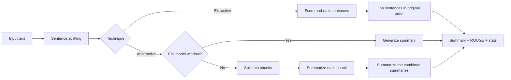

<div align="center">

# Multiple Techniques for Text Summarization

**18 summarization techniques. One API. Side-by-side comparison with ROUGE scores.**

From 1958's Luhn algorithm to BART, PEGASUS, and Longformer, run them all on your text with a single command.


[Quick start](#quick-start) •
[Techniques](#techniques) •
[Usage](#usage) •
[Which one should I use?](#which-technique-should-i-use) •
[Evaluation](#evaluation)

</div>

---

## Highlights

- **Every major approach in one place:** statistical, graph-based, embedding-based, and transformer summarizers.
- **Handles long documents:** abstractive models automatically split long text into chunks, summarize each, and merge the results.
- **Built-in evaluation:** ROUGE-1, ROUGE-2, and ROUGE-L scores, plus runtime and compression ratio for every technique.
- **Install only what you need:** dependencies load lazily. A missing package skips that technique and prints the `pip install` command.
- **Runs on CPU or GPU:** uses CUDA automatically when it's available.

## Quick start

Requires **Python 3.12 or newer** (tested on Python 3.12.7).

```bash
git clone https://github.com/NomanShahRaza/Multiple-Techniques-for-Text-Summarization.git
cd Multiple-Techniques-for-Text-Summarization

python -m venv .venv
.venv\Scripts\activate          # Windows
source .venv/bin/activate       # Linux / macOS

pip install -r requirements.txt
python Text_summarization_combine_techniques.py
```

This runs the seven classic techniques on the bundled sample article (`sample_text.txt`) and prints each summary with its statistics:

```text
Input: 507 words, 34 sentences

==============================================================================
TEXTRANK (extractive)
------------------------------------------------------------------------------
Scientists say they have discovered a new species of orangutans on Indonesia's
island of Sumatra. Researchers named the new species the Tapanuli orangutan. ...
[0.29s | 51 words | 10% of input]
```

<details>
<summary><b>Minimal install for the classic techniques only (no PyTorch)</b></summary>

```bash
pip install nltk numpy scikit-learn networkx sumy rouge-score
```

This covers `frequency`, `textrank`, `lexrank`, `lsa`, `luhn`, `kl`, and `sumbasic`, plus ROUGE evaluation.

</details>

## How it works



There are two families of summarization:

| | Extractive | Abstractive |
|---|---|---|
| **What it does** | Picks the most important sentences as they are | Writes new sentences that paraphrase the content |
| **Strengths** | Fast, faithful to the source, no GPU needed | Fluent, concise, reads like a human summary |
| **Trade-offs** | Can feel choppy | Needs neural models, can occasionally get facts wrong |

## Techniques

All techniques use `nltk` for sentence splitting. The tables below list the additional packages each one needs.

### Extractive

| Name | Technique | Requires |
|---|---|---|
| `frequency` | Scores sentences by the normalized frequency of their content words | none |
| `textrank` | PageRank over a TF-IDF sentence-similarity graph | `scikit-learn` `networkx` |
| `lexrank` | Eigenvector centrality over a sentence-similarity graph | `sumy` |
| `lsa` | Latent Semantic Analysis (SVD of the term-sentence matrix) | `sumy` |
| `luhn` | Clusters of significant words (Luhn, 1958) | `sumy` |
| `kl` | KL-Sum: minimizes divergence between summary and document word distributions | `sumy` |
| `sumbasic` | Word probabilities with redundancy down-weighting | `sumy` |
| `mmr` | Sentence embeddings + Maximal Marginal Relevance: relevant *and* non-redundant | `sentence-transformers` |
| `bert` | BERT-large embeddings + k-means clustering | `transformers` `scikit-learn` |
| `gpt2` | GPT-2 Medium embeddings + k-means clustering | `transformers` `scikit-learn` |
| `xlnet` | XLNet embeddings + k-means clustering | `transformers` `scikit-learn` |

### Abstractive

| Name | Model | Best for |
|---|---|---|
| `t5` | [`t5-base`](https://huggingface.co/t5-base) | Baseline text-to-text transformer |
| `t5-large` | [`t5-large`](https://huggingface.co/t5-large) | Better quality than T5-base, but slower |
| `flan-t5` | [`google/flan-t5-base`](https://huggingface.co/google/flan-t5-base) | Instruction-tuned T5, stronger than the original |
| `bart` | [`facebook/bart-large-cnn`](https://huggingface.co/facebook/bart-large-cnn) | News and articles |
| `distilbart` | [`sshleifer/distilbart-cnn-12-6`](https://huggingface.co/sshleifer/distilbart-cnn-12-6) | Smaller and faster than BART, with similar quality |
| `pegasus` | [`google/pegasus-cnn_dailymail`](https://huggingface.co/google/pegasus-cnn_dailymail) | Pre-trained specifically for summarization |
| `led` | [`pszemraj/led-base-book-summary`](https://huggingface.co/pszemraj/led-base-book-summary) | Long documents (up to 16k tokens) |

## Usage

### Command line

```bash
# List all techniques
python Text_summarization_combine_techniques.py --list

# Pick techniques, or groups: classic, extractive, abstractive, all
python Text_summarization_combine_techniques.py -m textrank,mmr,bart,pegasus

# Summarize your own file in 5 sentences
python Text_summarization_combine_techniques.py -f article.txt -n 5 -m extractive

# Score every summary against a human-written reference
python Text_summarization_combine_techniques.py -m all -r reference.txt
```

<details>
<summary><b>All command-line options</b></summary>

| Option | Description | Default |
|---|---|---|
| `-m`, `--methods` | Comma-separated techniques or groups (`classic`, `extractive`, `abstractive`, `all`) | `classic` |
| `-f`, `--file` | Input text file, or `-` to read from standard input | `sample_text.txt` |
| `-t`, `--text` | Input text passed directly on the command line | |
| `-n`, `--sentences` | Number of sentences for extractive techniques | `3` |
| `--max-length` | Maximum output tokens for abstractive models | `150` |
| `--min-length` | Minimum output tokens for abstractive models | `30` |
| `-r`, `--reference` | Reference summary file for ROUGE scoring | |
| `--list` | List available techniques and exit | |

</details>

### Python API

```python
from Text_summarization_combine_techniques import summarize, rouge_scores

text = open("sample_text.txt", encoding="utf-8").read()

summarize(text, "textrank", num_sentences=3)
summarize(text, "bart", max_length=120, min_length=40)
rouge_scores(reference="...", summary=summarize(text, "mmr"))
```

Use **any** Hugging Face seq2seq model with `hf_summary`:

```python
from Text_summarization_combine_techniques import hf_summary

hf_summary(text, "google/pegasus-xsum")                                     # one-sentence summary
hf_summary(text, "t5-small", prefix="summarize: ", max_input_tokens=512)    # tiny and fast
```

## Which technique should I use?

| Your situation | Use |
|---|---|
| No GPU, need it fast | `textrank`, `lexrank`, `lsa` |
| Best extractive quality | `mmr` |
| Best abstractive quality for news or articles | `bart`, `pegasus` |
| Abstractive, but faster | `distilbart` |
| Very long documents (reports, chapters) | `led` |

> [!NOTE]
> `bert`, `gpt2`, and `xlnet` reproduce the classic BERT-extractive approach for comparison.
> They're slow on CPU and scored lower than `mmr` in our tests.

## Evaluation

ROUGE measures how much a generated summary overlaps with a reference summary. Higher is better.

| Metric | Measures |
|---|---|
| **ROUGE-1** | Overlap of single words |
| **ROUGE-2** | Overlap of word pairs |
| **ROUGE-L** | Longest common subsequence, which reflects sentence structure |

> [!TIP]
> ROUGE rewards matching words, so abstractive models that paraphrase well can still score lower.
> Use it as a rough guide, and read the summaries too.

## Project structure

```text
.
├── Text_summarization_combine_techniques.py   # All techniques, the summarize() API, and the CLI
├── sample_text.txt                            # Sample news article used by default
├── requirements.txt                           # Dependencies, grouped by technique
└── README.md
```

---

<div align="center">

**Author:** [Noman Raza Shah](https://github.com/NomanShahRaza)

If this project helped you, consider [giving it a star](https://github.com/NomanShahRaza/Multiple-Techniques-for-Text-Summarization).

</div>
